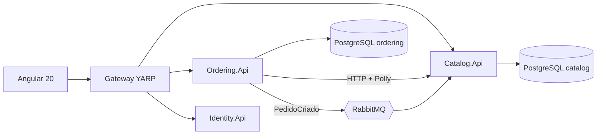

# store-microservices

Loja de estudo em **microsserviços .NET 10 + Angular 20**, com Clean Architecture, DDD, CQRS, mensageria e API Gateway.
Decisões e justificativas: [docs/decisoes-arquitetura.md](docs/decisoes-arquitetura.md).

## Arquitetura



## Estrutura

```
store-microservices/
├─ src/
│  ├─ Gateway/Store.Gateway
│  ├─ Services/
│  │  ├─ Catalog/   Catalog.Domain | Catalog.Application | Catalog.Infrastructure | Catalog.Api
│  │  ├─ Ordering/  Ordering.Domain | Ordering.Application | Ordering.Infrastructure | Ordering.Api
│  │  └─ Identity/  Identity.Api
│  ├─ BuildingBlocks/
│  │  ├─ BuildingBlocks.Contracts   (eventos de integração)
│  │  └─ BuildingBlocks.Application (Result, ICommandHandler, IQueryHandler, decorators)
│  └─ Web/store-web                 (Angular)
├─ tests/  Catalog.UnitTests | Ordering.UnitTests | (Catalog.IntegrationTests)
├─ docs/   decisoes-arquitetura.md
├─ docker-compose.yml
└─ .github/workflows/ci.yml
```

## Especificação por fase

### Fase 1 — Catalog.Api (Dia 1)
- Domínio: `Category`, `Product` (Sku e Money como value objects; `DebitStock`, `ChangePrice`).
- Casos de uso: criar/editar/excluir/obter produto; listar com **filtro por nome e categoria + paginação**; CRUD de categoria.
- CQRS com handlers próprios; FluentValidation via decorator; Result + ProblemDetails; Swagger.
- EF Core + PostgreSQL, migrations, seed de categorias.
- Testes unitários do domínio e dos handlers.
- Dockerfile multi-stage; compose com Postgres.
- **Aceite:** `docker compose up` → Swagger do Catalog funcionando com CRUD e paginação; testes verdes.

### Fase 2 — Gateway + Angular + Ordering (Dia 2)
- Gateway YARP roteando `/api/catalog/**` e `/api/orders/**`; CORS para o front.
- Angular: listagem de produtos (filtro com `debounceTime`, paginação), formulário reativo de criar/editar, exclusão com confirmação; facade + signals; interceptor de erro.
- Ordering: agregado `Order`/`OrderItem`; criar pedido consultando o Catálogo via `IProductCatalog` → `CatalogHttpAdapter` (Typed HttpClient + resiliência); frete com **Strategy** (keyed services).
- **Aceite:** front lista/edita produtos pelo gateway; pedido criado com preço vindo do Catálogo; derrubar o Catalog mostra o circuit breaker abrindo nos logs.

### Fase 3 — Eventos, JWT e acabamento (Dia 3)
- MassTransit + RabbitMQ: `PedidoCriadoIntegrationEvent` → Catalog baixa estoque (consumidor idempotente). Extra: Outbox.
- Identity.Api emitindo JWT; serviços com `[Authorize]`; interceptor de token e guard no Angular; tela de login.
- Health checks, Serilog, Correlation Id.
- CI no GitHub Actions; README final com prints.
- **Aceite:** criar pedido pelo front reduz o estoque no Catálogo; rotas protegidas exigem login.

### Fase 3.5 — GraphQL no Catálogo (opcional) — ADR-32
- Hot Chocolate no Catalog.Api: queries de produtos e categorias com filtro, ordenação, paginação por cursor e projeção; DataLoader para categoria (evitar N+1); limite de complexidade.
- Resolvers chamam os query handlers existentes (nenhuma regra nova na borda). Sem mutations.
- Gateway roteia `/graphql`; Angular passa a usar GraphQL na listagem de produtos (Apollo Angular ou `HttpClient` com POST simples). Criar/editar/excluir continuam em REST.
- **Aceite:** listagem do front via GraphQL trazendo só os campos usados; REST e GraphQL retornam os mesmos dados; testes dos handlers seguem verdes.

### Fase 4 — Deploy na AWS (opcional, depois da Fase 3) — ADR-26 a ADR-31
- Terraform: VPC (subnets públicas, sem NAT), ECR por serviço, cluster ECS com Service Connect, serviços Fargate (Gateway, Catalog, Ordering, Identity, RabbitMQ), ALB na frente do Gateway, RDS PostgreSQL (um banco por serviço), S3 + CloudFront para o Angular, Secrets Manager, CloudWatch Logs.
- GitHub Actions com OIDC: build, testes, push no ECR e deploy só do serviço alterado; publicação do front no S3 com invalidação do CloudFront.
- Antes de tudo: alerta no AWS Budgets. Depois da demo: tasks a zero ou `terraform destroy`.
- **Aceite:** front acessível pela URL do CloudFront; criar pedido reduz o estoque também na AWS; push na `main` publica automaticamente; ambiente recriável com `terraform apply`.

### Corte se faltar tempo (nesta ordem)
1. Fase 3.5 (GraphQL), Outbox e Testcontainers
2. Identity completo → JWT com chave fixa de desenvolvimento
3. RabbitMQ (manter só HTTP)
Nunca cortar: Fase 1 completa e o CRUD no Angular — são o núcleo do teste.

## Como rodar
```bash
docker compose up -d
# Gateway: http://localhost:5000  |  Front: cd src/Web/store-web && npm start  →  http://localhost:4200
```
