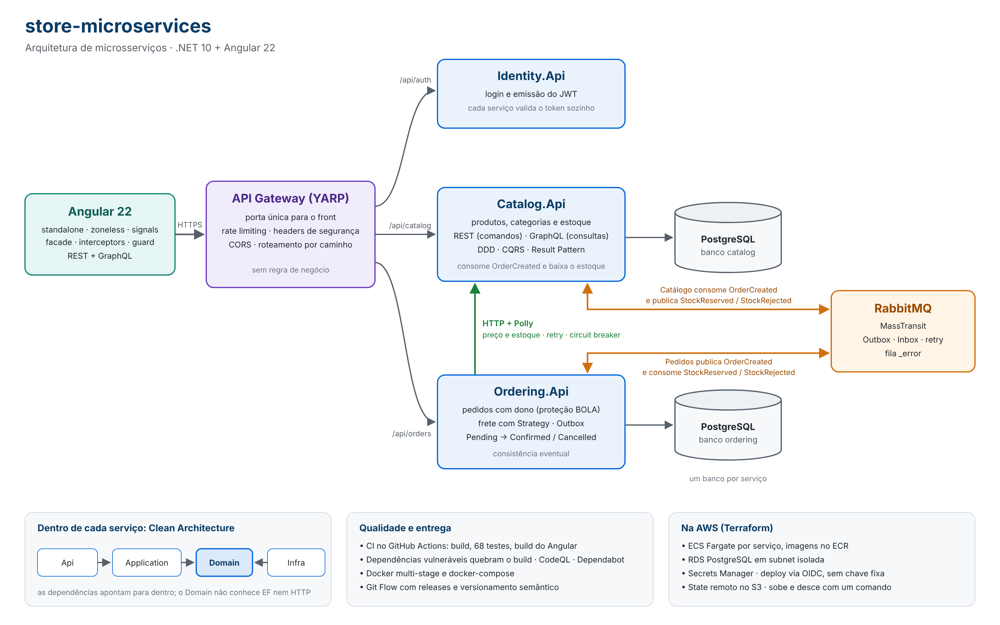
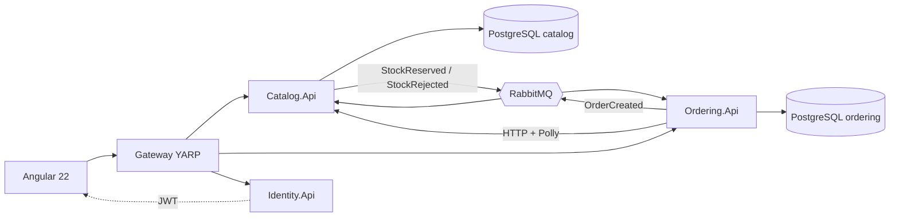

# store-microservices

Plataforma de e-commerce em **microsserviços .NET 10 + Angular 22**: Catálogo, Pedidos e Identidade, cada um com seu banco, atrás de um API Gateway.

O projeto demonstra, de ponta a ponta, como eu estruturo um sistema distribuído:
- **Arquitetura:** Clean Architecture por serviço, DDD tático (agregados, value objects), CQRS sem MediatR, Result Pattern e decorators para validação e log.
- **Integração:** HTTP com resiliência (Polly) quando a resposta precisa ser imediata; eventos no RabbitMQ com Transactional Outbox e consumidor idempotente quando a consistência pode ser eventual.
- **Front-end:** Angular 22 standalone e zoneless, com signals, facade e formulários reativos tipados; REST para comandos e GraphQL para consultas.
- **Segurança:** JWT validado em cada serviço, proteção contra BOLA/IDOR, rate limiting e headers de segurança no Gateway, análise de dependências e CodeQL no pipeline.
- **Entrega:** Docker, CI no GitHub Actions, Git Flow com versionamento semântico e infraestrutura como código (Terraform) para a AWS.

Cada decisão está registrada como ADR, com o problema que resolve e as alternativas descartadas: [docs/decisoes-arquitetura.md](docs/decisoes-arquitetura.md).
Para ir direto ao código de cada recurso: [docs/guia-do-codigo.md](docs/guia-do-codigo.md).

## Arquitetura



Versão simplificada do fluxo:



## Estrutura

```
store-microservices/
├─ src/
│  ├─ Gateway/Store.Gateway
│  ├─ Services/
│  │  ├─ Catalog/   Catalog.Domain | Catalog.Application | Catalog.Infrastructure | Catalog.Api
│  │  ├─ Ordering/  Ordering.Domain | Ordering.Application | Ordering.Infrastructure | Ordering.Api
│  │  └─ Identity/  Identity.Api
│  ├─ BuildingBlocks/
│  │  ├─ BuildingBlocks.Contracts   (eventos de integração)
│  │  └─ BuildingBlocks.Application (Result, ICommandHandler, IQueryHandler, decorators)
│  └─ Web/store-web                 (Angular)
├─ tests/  Catalog.UnitTests | Ordering.UnitTests | smoke (teste de segurança ponta a ponta)
├─ docs/   decisoes-arquitetura.md | guia-do-codigo.md | fluxo-git.md
├─ infra/terraform/   bootstrap (state) | aws (ambiente na AWS)
├─ docker-compose.yml
└─ .github/workflows/ci.yml
```

## Entregas por versão

O projeto evoluiu em marcos, cada um fechado numa release com tag (detalhes no [CHANGELOG](CHANGELOG.md)).

| Versão | Entrega | Principais decisões |
|---|---|---|
| `0.1.0` | **Catálogo:** produtos e categorias com CRUD, filtro e paginação | Clean Architecture, DDD tático, CQRS, Result Pattern, decorators (ADR-01 a ADR-22) |
| `0.2.0` | **Pedidos, Gateway e Angular:** pedido consultando o Catálogo; frete com Strategy; front com listagem e formulário | API Gateway (YARP), HttpClient tipado com Polly, ACL, facade e signals no Angular |
| `1.0.0` | **Eventos, autenticação e observabilidade:** o pedido baixa o estoque por evento; login com JWT | RabbitMQ + MassTransit com Outbox e Inbox, coreografia, JWT stateless, health checks, correlation id, CI |
| `1.1.0` | **GraphQL no Catálogo** para as consultas do front | REST para comandos, GraphQL para leitura, sobre os mesmos casos de uso (ADR-32) |
| *Não publicado* | **Infraestrutura na AWS** em Terraform: rede, ECR, banco e segredos | State remoto com lock, subnets isoladas, OIDC no deploy, Secrets Manager (ADR-26 a ADR-40) |
| *Não publicado* | **Segurança de aplicação** | BOLA/IDOR, rate limiting, headers, SCA e CodeQL no pipeline (ADR-41 a ADR-43) |

### Critérios de aceite verificados
- Catálogo com CRUD, filtro por nome e categoria e paginação, pela API e pelo Angular.
- Pedido criado com preço vindo do Catálogo; com o Catálogo fora do ar, o circuit breaker abre e a API responde 503.
- Criar um pedido baixa o estoque no Catálogo por evento, e o pedido passa de `Pending` para `Confirmed` (ou `Cancelled`, sem estoque).
- Rotas de escrita exigem login; um cliente não lê nem cancela o pedido de outro (`tests/smoke/security-smoke.ps1`).
- Infraestrutura da AWS criada e destruída com `terraform apply` e `terraform destroy` ([infra/terraform](infra/terraform/README.md)).

## Como rodar

### Pré-requisitos
.NET 10 SDK, Node 24 LTS (ou 22.22+), a ferramenta do EF Core (`dotnet tool install -g dotnet-ef`) e um PostgreSQL. Docker Desktop para a opção 1.

### Conexão com o banco (sem senha no repositório)
As APIs leem a variável de ambiente **`POSTGRES_CONNECTION`** com host, porta, usuário e senha, sem o nome do banco:
```powershell
[Environment]::SetEnvironmentVariable('POSTGRES_CONNECTION', 'Host=localhost;Port=5432;Username=postgres;Password=SUA_SENHA', 'User')
```
Cada serviço completa com o próprio banco (`catalog`, `ordering`), definido em `Database:Name` no appsettings. Reabra terminal e Visual Studio depois de criar a variável.

### Outros segredos
```powershell
[Environment]::SetEnvironmentVariable('Jwt__SigningKey', '<frase com 32+ caracteres>', 'User')
[Environment]::SetEnvironmentVariable('RabbitMq__Password', '<senha do RabbitMQ>', 'User')
```
No Docker, os mesmos valores vão no `.env` (`JWT_SIGNING_KEY`, `RABBITMQ_PASSWORD`). Para rodar pelo Visual Studio, suba só o RabbitMQ: `docker compose up -d rabbitmq`.

Login de demonstração: `admin@store.dev` / `Store@2026`.


### Banco de dados (migrations)
As migrations ficam no repositório e são aplicadas automaticamente quando cada API sobe em Development (criam os bancos `catalog` e `ordering`).
Ao mudar o modelo de um serviço, gere uma nova:
```powershell
dotnet ef migrations add <Nome> -p src/Services/<Servico>/<Servico>.Infrastructure -s src/Services/<Servico>/<Servico>.Api -o Persistence/Migrations
```

### Opção 1 — back-end inteiro no Docker
Copie `.env.example` para `.env` e defina `POSTGRES_PASSWORD` (o `.env` não vai para o Git).
```powershell
docker compose up -d --build
```
| Serviço | Endereço |
|---|---|
| Gateway (entrada do front) | http://localhost:5000 |
| Catalog.Api | http://localhost:5101/scalar |
| Ordering.Api | http://localhost:5102/scalar |
| Identity.Api | http://localhost:5103/scalar |
| RabbitMQ (painel) | http://localhost:15672 |

As migrations e o seed de categorias são aplicados na inicialização.

### Opção 2 — no Visual Studio (para debugar)
Back e front têm **solutions separadas**, cada uma com o próprio botão Iniciar:

| Solution | Conteúdo | Como rodar |
|---|---|---|
| `store-server.slnx` (raiz) | Gateway, serviços, building blocks e testes | Perfil **"Back-end (Gateway + Catalog + Ordering)"** no menu ao lado do botão Iniciar (definido em `store-server.slnLaunch`) |
| `src/Web/store-web/store-web.slnx` | Projeto Angular (`store-web.esproj`) | F5: roda `npm start` e abre o navegador em http://localhost:4200 com depuração |

As APIs usam o PostgreSQL apontado por `POSTGRES_CONNECTION` (um servidor, um banco por serviço, criados pelas migrations).

### Front-end pela linha de comando
```powershell
cd src/Web/store-web
npm install
npm start
```
Abre em http://localhost:4200 e conversa com o Gateway em http://localhost:5000.

### Testes
```powershell
dotnet test
```

### Teste de fumaça de segurança
Com o back-end rodando, confere headers, BOLA/IDOR e rate limiting pelo Gateway:
```powershell
powershell -ExecutionPolicy Bypass -File .\tests\smoke\security-smoke.ps1
```
